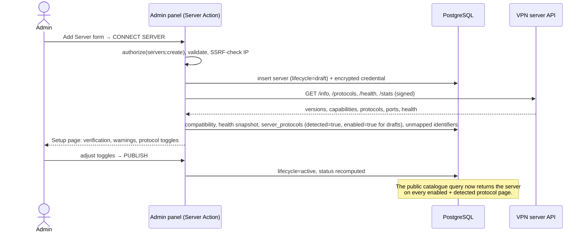

# 1. System architecture

## Goals that shape the design

1. **Adding a server needs no code change.** A prepared VPS is registered in the admin panel; the website connects, verifies the provisioning service, detects protocols and publishes the server on every matching protocol page.
2. **The browser never talks to a VPN server.** Every request goes *Frontend → Website backend → Provisioning layer → Node driver → VPN server*.
3. **No arbitrary commands.** The website only knows a fixed set of predefined operations (get info, health, protocols, stats, create/get/find/revoke/renew account, restart agent).
4. **The existing server script stays authoritative.** The website does not invent how accounts are created on the server. It defines a clean interface; the owner's node API implements it on top of the script ([10-script-api-prompt.md](10-script-api-prompt.md)).

## Components

```mermaid
flowchart LR
  subgraph Browser
    U[Public user]
    A[Administrator]
  end
  subgraph Website["Website (Next.js, Node.js)"]
    PX[proxy.ts<br/>CSP nonce, admin gate]
    PUB[Public pages + /api/public/*]
    ADM[Admin panel<br/>Server Components + Server Actions]
    SVC[Domain services<br/>servers · protocols · provisioning · auth]
  end
  subgraph Worker["Worker process"]
    W[BullMQ consumer<br/>create · reconcile · sweep]
  end
  subgraph Provisioning["Provisioning layer (src/server/provisioning + nodes)"]
    PS[ProvisioningService<br/>lifecycle, idempotency, capacity]
    AD[Protocol adapters]
    DR[Node drivers<br/>contract-v1 · future script driver]
    TR[Signed HTTPS transport<br/>pinned DNS, TLS modes, SSRF guard]
  end
  PG[(PostgreSQL)]
  RD[(Redis)]
  subgraph VPS["Each VPN server"]
    AG[Provisioning service / agent]
    SC[Existing installation script]
  end

  U --> PX --> PUB --> SVC
  A --> PX --> ADM --> SVC
  SVC --> PG
  SVC --> RD
  SVC -->|enqueue| RD
  RD --> W --> PS
  SVC -->|connect / sync / test| DR
  PS --> AD --> DR --> TR -->|HMAC-signed HTTPS| AG --> SC
```



| Component | Responsibility | Code |
| --- | --- | --- |
| **Web app** | Public site, admin panel, JSON API. Validates input, authorises, writes the database, enqueues jobs. | `src/app`, `src/proxy.ts` |
| **Domain services** | Server management, capability detection, protocol registry, public catalogue, admin auth, audit. | `src/server/{servers,protocols,auth,admins,…}` |
| **Provisioning layer** | The only code that talks to VPN servers. Lifecycle orchestration, protocol adapters, node drivers and the transport. | `src/server/provisioning`, `src/server/nodes` |
| **Worker** | Executes provisioning jobs off the request path, reconciles uncertain outcomes, sweeps stranded requests and expired one-time results, runs the health monitor and account expiry ([09-public-site.md](09-public-site.md#background-jobs)). | `src/worker` |
| **PostgreSQL** | Source of truth (servers, protocols, accounts, requests, logs). | `src/server/db/schema.ts`, `drizzle/` |
| **Redis** | Job queue (BullMQ), rate limiting. Losing Redis never loses state: the sweeper re-enqueues from the database. | `src/server/redis.ts`, `provisioning/queue.ts` |
| **VPN node** | Your installation script plus a small provisioning service that exposes predefined operations over HTTPS. | out of repo (the owner's node API); dev simulator in `mock-node/`, demo fleet in `scripts/demo-nodes.ts` |

## Key flows

### Add server → connect → detect → publish



### Sync (e.g. WireGuard installed later)

`Sync` re-runs detection. Newly reported protocols on a published server are stored as **detected but disabled** ("Available") until an admin enables them; protocols the server stops reporting become undetected and immediately disappear from public pages (the admin's switch is remembered for when they return).

### Account creation (public form → `POST /api/public/accounts`)

```mermaid
sequenceDiagram
  actor User
  participant API as Web (request)
  participant DB as PostgreSQL
  participant Q as Redis queue
  participant W as Worker
  participant Node as VPN server
  User->>API: POST create (fields, idempotency key)
  API->>API: validate (protocol definition + adapter guards), rate limit
  API->>DB: TX: lock server + server_protocol, check status/capacity,<br/>reserve slot, pending account, request (encrypted input)
  API->>Q: enqueue create(requestId)
  API-->>User: 202 {requestId, claimToken}
  W->>DB: claim request (queued → in_flight)
  W->>Node: POST /accounts (Idempotency-Key = requestId)
  alt success
    Node-->>W: account + config
    W->>DB: account active, safe metadata, encrypted one-time result
  else definite failure
    W->>DB: failed, capacity released, safe error
  else timeout / reset after sending
    W->>DB: uncertain
    W->>Node: GET /accounts/by-request/{requestId}
    Note over W,Node: found → success; not found → resend with same id
  end
  User->>API: poll status (claimToken)
  API-->>User: config (decrypted per request, until PROVISION_RESULT_TTL_SECONDS)
```

## Technology

| Concern | Choice | Notes |
| --- | --- | --- |
| Frontend | Next.js 16 (App Router), React 19, TypeScript, Tailwind CSS 4, shadcn/ui-style components on Radix | Server Components for data, Server Actions for admin mutations; light/dark/system themes; responsive. |
| Backend | Node.js 22 + TypeScript inside Next.js; separate worker process from the same codebase | Domain logic lives in `src/server`, shared by web and worker. |
| Database | PostgreSQL 16 with Drizzle ORM | Migrations in `drizzle/`, generated by `drizzle-kit`. |
| Queue / cache / rate limits | Redis 7 + BullMQ | |
| HTTP to nodes | undici with per-server agents | DNS pinned to the configured IP, custom CA / pinned certificate / mTLS. |
| Crypto | AES-256-GCM keyring, Argon2id, HMAC-SHA256, TOTP | |
| Tests | Vitest (unit + integration against real Postgres/Redis + in-process mock node), Playwright smoke run | |
| Deployment | Docker image with three roles (web, worker, migrate), docker-compose with Postgres, Redis and Caddy (automatic HTTPS) | |

## Deployment topology

```
Internet ─▶ Caddy (TLS, sets X-Forwarded-For) ─▶ web (Next.js standalone, port 3000, not published)
                                                   │
                                   worker ◀── Redis ┤
                                                   └─▶ PostgreSQL
worker / web ─▶ HTTPS (signed) ─▶ VPN servers (provisioning API port, firewalled to the website's IP)
```

* Run one or more `web` replicas behind Caddy; the worker can scale horizontally (jobs are idempotent and guarded by database state).
* Restrict each VPN server's management port to the website's egress IP in the server firewall.

## Folder structure

```
vpn-platform/
├── docs/                       Design documents (this folder)
├── drizzle/                    SQL migrations (generated, committed)
├── deploy/Caddyfile            Reverse proxy / TLS
├── mock-node/                  Development & test simulator of the node API (NOT the real agent)
├── scripts/                    migrate, seed, create-admin (bundled to dist/ for Docker); node-check, node-selftest.py, demo fleet
├── src/
│   ├── proxy.ts                CSP nonce + optimistic admin redirect (Next 16 "proxy")
│   ├── app/
│   │   ├── (public)/…          Public site: home, [protocol]/[country]/[server], server-status, report, my-accounts, legal pages
│   │   ├── api/public/…        Public catalogue (read-only), account creation + polling, reports
│   │   ├── api/health          Liveness/readiness
│   │   └── admin/
│   │       ├── login/…         Password + MFA
│   │       └── (panel)/…       Dashboard, servers, protocols, accounts, reports, logs, admins, settings, account
│   ├── components/             UI kit (ui/), admin widgets, public site (public/), theme, avatar
│   ├── hooks/, lib/            Client-safe helpers (no server imports)
│   ├── server/                 Server-only domain code
│   │   ├── db/                 Drizzle schema + client
│   │   ├── auth/               Passwords, sessions, MFA, RBAC, rate limiting, guards
│   │   ├── admins/, accounts/, logs/, dashboard/, settings/, reports/
│   │   ├── public/             Public catalogue (snapshot query, cache) and JSON API helpers
│   │   ├── servers/            Server CRUD, lifecycle, status model, connect/sync/detection, health monitor
│   │   ├── protocols/          Registry, validation (reserved slugs), identifiers, seed data
│   │   ├── nodes/              Node API contract, signing, transport, drivers, compatibility
│   │   ├── provisioning/       Service (lifecycle), adapters, input, presentation, capacity, quota, expiry, queue
│   │   ├── crypto/, logging/, audit.ts, avatar.ts, captcha.ts, env.ts, redis.ts
│   └── worker/                 Worker entry point
└── tests/                      unit/ and integration/ (Vitest)
```
