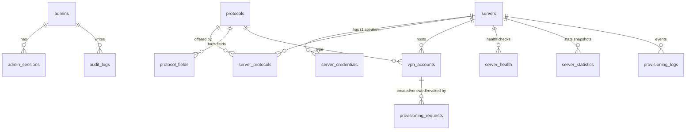

# 2. PostgreSQL schema

Source of truth: [`src/server/db/schema.ts`](../src/server/db/schema.ts). Migrations: [`drizzle/`](../drizzle). Apply with `npm run db:migrate`, seed built-in protocols with `npm run db:seed` (idempotent; never overwrites admin edits).



## Tables

| Table | Purpose | Notable columns |
| --- | --- | --- |
| `admins` | Administrator accounts | `email` (unique, case-insensitive), `password_hash` (Argon2id), `role`, `is_active`, `mfa_enabled`, `mfa_secret_encrypted`, `mfa_last_used_step` (TOTP replay guard), `mfa_recovery_code_hashes`, `failed_login_count`, `locked_until`, `password_changed_at` |
| `admin_sessions` | Server-side sessions | `token_hash` (SHA-256 of the cookie token), `mfa_verified`, `idle_expires_at`, `expires_at`, `revoked_at`, `ip`, `user_agent` |
| `servers` | Registered VPN servers | `name` (unique among non-deleted), `hostname`, `ip_address`, `country`, `country_code`, `city`, `region`, `provider`, `api_port`, `api_base_path`, `driver`, `lifecycle`, `health_status`, `status`, `compatibility`, `max_accounts`, `current_accounts`, `provisioning_version`, `api_version`, `capabilities`, `unmapped_protocols`, `sync_warnings`, `last_seen_at`, `last_successful_connection_at`, `last_sync_at`, `last_health_check_at`, `last_error`, `consecutive_failures`, `published_at`, `deleted_at` (soft delete) |
| `server_credentials` | Per-server API credentials (one active row) | `auth_method` (`hmac_sha256` / `bearer_token`), `key_id`, `secret_encrypted`, `tls_mode`, `tls_server_name`, `ca_certificate_pem`, `pinned_fingerprint_sha256`, `client_certificate_pem`, `client_key_encrypted`, `version` (rotation), `revoked_at` |
| `protocols` | Protocol registry | `slug` (page URL), `name`, `description`, `icon`, `category`, `adapter_key`, `node_identifiers` (what servers may report), `enabled`, `is_system`, `display_order`, `duration_options`, `default_duration_days`, `output_fields` (presentation), `max_accounts_per_ip_per_day` |
| `protocol_fields` | Dynamic form definition | `key`, `label`, `type` (`text`/`password`/`select`/`number`/`duration`), `required`, `placeholder`, `help_text`, `options`, `validation` (pattern/min/max), `default_value`, `display_order` |
| `server_protocols` | **Auto-publishing table** | `enabled` (admin), `detected` (server reported it), `service_status`, `node_identifier`, `port`, `ports` (map), `transports`, `max_accounts` (per protocol), `current_accounts`, `metadata`, `first_detected_at`, `last_detected_at` |
| `vpn_accounts` | Every provisioned account | `server_id`, `protocol_id`, `remote_account_id`, `username`, `status` (`pending`/`active`/`expired`/`revoked`/`failed`), `duration_days`, `activated_at`, `expires_at`, `metadata` (**safe values only**), `failure_code/message`, `client_ip_hash`, `holds_capacity` |
| `provisioning_requests` | Lifecycle + idempotency of every create/renew/revoke | `id` (= request id sent to the node), `idempotency_key` (unique), `operation`, `state` (`queued`/`in_flight`/`uncertain`/`succeeded`/`failed`), `attempts`, `input_digest`, `input_encrypted` (cleared at the end), `claim_token_hash`, `result_encrypted` + `result_expires_at` (one-time delivery), `error_code/message` |
| `server_health` | Health check history | `reachable`, `status`, `latency_ms`, CPU/RAM/disk/load/uptime, `services`, `error_code/message` |
| `server_statistics` | Stats snapshots from `/stats` | accounts total/by protocol, online users, bandwidth |
| `provisioning_logs` | Operational events (Admin → Logs, dashboard feed) | `event`, `level`, `status`, server/protocol/account/request/admin ids, safe `message`, redacted `details`, `duration_ms` |
| `audit_logs` | Administrator audit trail | `admin_id`, `admin_email` snapshot, `action`, `target_type/id`, `success`, `ip`, `user_agent`, redacted `details` |

## Server status model

Two independent inputs plus capacity decide the public status:

| Column | Set by | Values |
| --- | --- | --- |
| `lifecycle` | Administrator | `draft` (added, not published) · `active` · `maintenance` · `disabled` |
| `health_status` | Connection tests / sync / (phase 18) monitor | `unknown` · `online` · `degraded` · `offline` |
| `compatibility` | Version check on every contact | `unknown` · `compatible` · `outdated` · `unsupported` |

`status` (stored for fast listing, recomputed in SQL by `refreshServerStatus()` whenever an input changes):

```
draft                                   → pending
disabled                                → disabled
maintenance                             → maintenance
health offline/unknown OR unsupported   → offline
current_accounts >= max_accounts        → full
otherwise                               → online      (degraded and outdated still serve)
```

The same logic exists in TypeScript (`computeServerStatus`) and is unit-tested.

## Auto-publishing query

A server is listed on `/<protocol>` when **all** hold (see `src/server/public/catalog.ts`):

```sql
protocols.enabled
AND server_protocols.enabled AND server_protocols.detected
AND servers.deleted_at IS NULL
AND servers.lifecycle IN ('active','maintenance')
AND servers.compatibility <> 'unsupported'
AND servers.status IN ('online','full','maintenance')
```

Maintenance and full servers are listed but marked unavailable; offline/disabled/draft servers are not listed. Nothing about servers is hard-coded in the frontend.

## Capacity accounting

`servers.current_accounts` and `server_protocols.current_accounts` count **pending + active** accounts. A create request reserves a slot with a conditional `UPDATE … WHERE current < max` inside the same transaction that inserts the pending account, so concurrent requests cannot oversubscribe a server. Slots are released exactly once (guarded by `vpn_accounts.holds_capacity`) when an account fails, is revoked or (phase 19) expires.

## What is never stored

* Plaintext API secrets, client keys, MFA secrets → only AES-256-GCM ciphertexts bound to their row (AAD).
* Account passwords, UUIDs, private keys, share links or config files → delivered once from an encrypted, TTL-limited `result_encrypted` that the sweeper erases.
* Raw client IPs of public users → keyed HMAC (`client_ip_hash`).

## Indexes

Every foreign-key path used by the admin panel and the catalogue is indexed: `server_protocols(protocol_id, enabled, detected)`, `vpn_accounts(server_id, status)`, `vpn_accounts(protocol_id, status)`, partial `vpn_accounts(expires_at) WHERE status='active'` (expiry sweeps), `provisioning_requests(state, updated_at)`, `server_health(server_id, checked_at desc)`, `provisioning_logs(created_at desc)`, etc.

## Retention (to configure in phase 18/21)

`server_health`, `server_statistics`, `provisioning_logs` grow continuously; plan a daily job deleting rows older than e.g. 30/90/180 days. `audit_logs` should be kept longer (1 year+).
