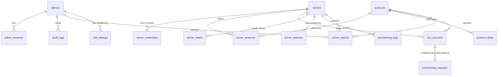

# 2. PostgreSQL schema

Source of truth: [`src/server/db/schema.ts`](../src/server/db/schema.ts). Migrations: [`drizzle/`](../drizzle). Apply with `npm run db:migrate`, seed built-in protocols with `npm run db:seed` (idempotent; never overwrites admin edits).



## Tables

| Table | Purpose | Notable columns |
| --- | --- | --- |
| `admins` | Administrator accounts | `email` (unique, case-insensitive), `password_hash` (Argon2id), `role`, `is_active`, `mfa_enabled`, `mfa_secret_encrypted`, `mfa_last_used_step` (TOTP replay guard), `mfa_recovery_code_hashes`, `failed_login_count`, `locked_until`, `password_changed_at` |
| `admin_sessions` | Server-side sessions | `token_hash` (SHA-256 of the cookie token), `mfa_verified`, `idle_expires_at`, `expires_at`, `revoked_at`, `ip`, `user_agent` |
| `servers` | Registered VPN servers | `name` and `slug` (URL name such as `de1`; both unique among non-deleted), `hostname`, `ip_address`, `country`, `country_code`, `city`, `region`, `provider`, `api_port`, `api_base_path`, `driver`, `lifecycle`, `health_status`, `status`, `compatibility`, `max_accounts`, `current_accounts`, `provisioning_version`, `api_version`, `capabilities`, `unmapped_protocols`, `sync_warnings`, `last_seen_at`, `last_successful_connection_at`, `last_sync_at`, `last_health_check_at`, `last_latency_ms`, `last_error`, `consecutive_failures`, `published_at`, `deleted_at` (soft delete) |
| `server_credentials` | Per-server API credentials (one active row) | `auth_method` (`hmac_sha256` / `bearer_token`), `key_id`, `secret_encrypted`, `tls_mode`, `tls_server_name`, `ca_certificate_pem`, `pinned_fingerprint_sha256`, `client_certificate_pem`, `client_key_encrypted`, `version` (rotation), `revoked_at` |
| `protocols` | Protocol registry | `slug` (page URL), `name`, `description`, `icon`, `category`, `adapter_key`, `node_identifiers` (what servers may report), `enabled`, `is_system`, `display_order`, `duration_options`, `default_duration_days`, `output_fields` (presentation), `max_accounts_per_ip_per_day` |
| `protocol_fields` | Dynamic form definition | `key`, `label`, `type` (`text`/`password`/`select`/`number`/`duration`), `required`, `placeholder`, `help_text`, `options`, `validation` (pattern/min/max), `default_value`, `display_order` |
| `server_protocols` | **Auto-publishing table** | `enabled` (admin), `detected` (server reported it), `service_status`, `node_identifier`, `port`, `ports` (map), `transports`, `max_accounts` (per protocol), `current_accounts`, `quota_limit` (creations per reset window, null = none), `quota_used` + `quota_window_start` (lazy reset), `metadata`, `first_detected_at`, `last_detected_at`, `account_lookup_ok_at` (last time the account check found an account of this protocol there; until then its "not found" answers are not trusted; reset when the server's connection changes) |
| `vpn_accounts` | Every provisioned account | `server_id`, `protocol_id`, `remote_account_id`, `username`, `status` (`pending`/`active`/`expired`/`revoked`/`failed`/`removed`; `removed` = deleted by the server itself before it expired, found by the account check), `duration_days`, `activated_at`, `expires_at`, `revoked_at` (admin revoke, or when found removed), `checked_at` / `missing_since` (account check), `metadata` (**safe values only**), `failure_code/message`, `client_ip_hash`, `holds_capacity`, `quota_window_start` (window the creation was counted in, for refunds) |
| `provisioning_requests` | Lifecycle + idempotency of every create/renew/revoke | `id` (= request id sent to the node), `idempotency_key` (unique), `operation`, `state` (`queued`/`in_flight`/`uncertain`/`succeeded`/`failed`), `attempts`, `input_digest`, `input_encrypted` (cleared at the end), `claim_token_hash`, `result_encrypted` + `result_expires_at` (one-time delivery), `error_code/message` |
| `server_health` | Health check history | `reachable`, `status`, `latency_ms`, CPU/RAM/disk/load/uptime, `services`, `error_code/message` |
| `server_statistics` | Stats snapshots from `/stats` | accounts total/by protocol, online users, bandwidth |
| `provisioning_logs` | Operational events (Admin → Logs, dashboard feed) | `event`, `level`, `status`, server/protocol/account/request/admin ids, safe `message`, redacted `details`, `duration_ms` |
| `audit_logs` | Administrator audit trail | `admin_id`, `admin_email` snapshot, `action`, `target_type/id`, `success`, `ip`, `user_agent`, redacted `details` |
| `site_settings` | Admin → Site settings (single row, `id = 1`) | `data` (JSON validated by `src/lib/site-settings.ts`), `updated_by`, `updated_at` |
| `server_reports` | "Report a problem" submissions | `server_id`, `protocol_id` (both optional), `category`, `message`, `contact_email`, `status` (`open`/`resolved`), `client_ip_hash`, `resolved_by`, `resolved_at`, `admin_note` |

## Server status model

Two independent inputs plus capacity decide the public status:

| Column | Set by | Values |
| --- | --- | --- |
| `lifecycle` | Administrator | `draft` (added, not published) · `active` · `maintenance` · `disabled` |
| `health_status` | Connection tests / sync / health monitor | `unknown` · `online` · `degraded` · `offline` |
| `compatibility` | Version check on every contact | `unknown` · `compatible` · `outdated` · `unsupported` |

`status` (stored for fast listing, recomputed in SQL by `refreshServerStatus()` whenever an input changes):

```
draft                                   → pending
disabled                                → disabled
maintenance                             → maintenance
health offline/unknown OR unsupported   → offline
current_accounts >= max_accounts        → full
otherwise                               → online      (degraded and outdated still serve)
```

The same logic exists in TypeScript (`computeServerStatus`) and is unit-tested.

## Auto-publishing query

A server is listed on `/<protocol>` when **all** hold (see `src/server/public/catalog.ts`):

```sql
protocols.enabled
AND server_protocols.enabled AND server_protocols.detected
AND servers.deleted_at IS NULL
AND servers.lifecycle IN ('active','maintenance')
AND servers.compatibility <> 'unsupported'
AND servers.status IN ('online','full','maintenance')   -- browse pages only
```

Maintenance and full servers are listed but marked unavailable. Offline servers are left out of the protocol and country pages but stay on the server status page and on their own server page (marked offline); disabled and draft servers are never listed. Nothing about servers is hard-coded in the frontend.

## Capacity accounting

`servers.current_accounts` and `server_protocols.current_accounts` count **pending + active** accounts. A create request reserves a slot with a conditional `UPDATE … WHERE current < max` inside the same transaction that inserts the pending account, so concurrent requests cannot oversubscribe a server. Slots are released exactly once (guarded by `vpn_accounts.holds_capacity`) when an account fails, is revoked, expires or is found removed from its server.

The creation quota (`server_protocols.quota_limit`) counts creations per reset window instead of live accounts and is reserved in the same `UPDATE`; it is given back only for a definite provisioning failure in the same window. See [Public site → Quota model](09-public-site.md#quota-model).

## What is never stored

* Plaintext API secrets, client keys, MFA secrets → only AES-256-GCM ciphertexts bound to their row (AAD).
* Account passwords, UUIDs, private keys, share links or config files → only in the encrypted, TTL-limited `result_encrypted` that the claim-token holder can read until it expires and the sweeper erases it.
* Raw client IPs of public users → keyed HMAC (`client_ip_hash`).

## Indexes

Every foreign-key path used by the admin panel and the catalogue is indexed: `server_protocols(protocol_id, enabled, detected)`, `vpn_accounts(server_id, status)`, `vpn_accounts(protocol_id, status)`, partial `vpn_accounts(expires_at) WHERE status='active'` (expiry sweeps), `provisioning_requests(state, updated_at)`, `server_health(server_id, checked_at desc)`, `provisioning_logs(created_at desc)`, etc.

## Retention

`server_health` is kept for 7 days (the worker purges older rows hourly). `server_statistics`, `provisioning_logs` and `server_reports` still grow continuously; plan a job deleting rows older than e.g. 90/180 days before production (phase 21). `audit_logs` should be kept longer (1 year+).
