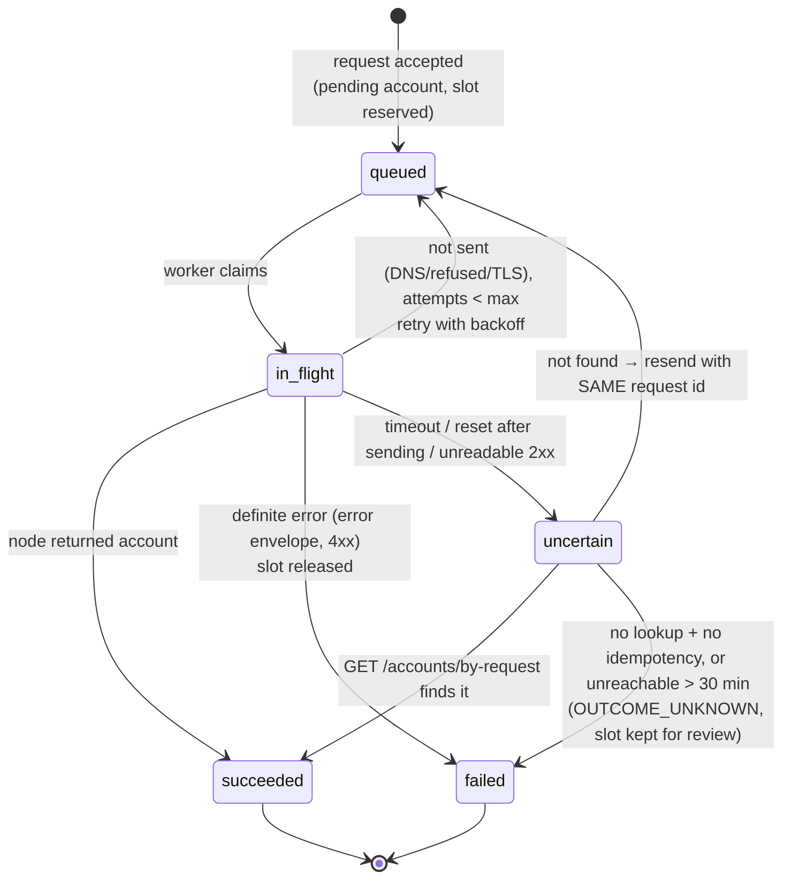

# 5. Provisioning interface, adapters and lifecycle

## Layers

```
Universal request (protocol slug + form values)
  │  ProvisioningService  — lifecycle, idempotency, rate limits, capacity, queue, result delivery
  │  ProtocolAdapter      — protocol-specific validation, request shaping, response parsing/presentation
  │  NodeDriver           — predefined operations against one kind of server API
  ▼  Transport            — signed HTTPS, pinned DNS, TLS modes, timeouts, size limits, error classification
VPN server
```

### NodeDriver (`src/server/nodes/driver.ts`)

```ts
interface NodeDriver {
  getInfo(); getHealth(); getProtocols(); getStats();
  createAccount(spec: AccountSpec, requestId: string): Promise<NodeAccount>;
  getAccount(accountId); findAccountByRequestId(requestId);
  revokeAccount(accountId, requestId); renewAccount(accountId, days, requestId);
  listAccounts({ protocol, cursor, limit }); restartAgent();
}
```

There is intentionally **no generic "execute" method**. Drivers are registered in `src/server/nodes/drivers/index.ts` and selected per server (`servers.driver`). Today: `contract-v1` (see [04-node-api-contract.md](04-node-api-contract.md)), which the owner's node API implements, so no script-specific driver is needed.

### ProtocolAdapter (`src/server/provisioning/types.ts`)

```ts
interface ProtocolAdapter {
  key: string;                         // protocols.adapter_key
  inputGuards: { username?, password?, transport?… };  // hard safety rules, cannot be relaxed by admins
  requiredInputs: string[];            // fields the protocol definition must contain
  outputFields: OutputFieldDefinition[]; // values it can produce (+ default labels/visibility)
  defaultFields: SeedField[];          // default form for new protocols using it
  buildSpec(input, ctx): AccountSpec;  // normalized request → node command
  parseAccount(nodeAccount, ctx, input): ProvisionedAccount; // node result → values + artifacts
}
```

| Adapter key | Protocols | Output |
| --- | --- | --- |
| `ssh`, `ssh-ssl`, `ssh-websocket`, `slowdns`, `udp-custom` | SSH family (one system account, different emphasis) | Host, IP, username, password, OpenSSH/Dropbear/SSL/WS/WS-TLS/UDP/SlowDNS ports, SlowDNS NS + key, WS payload, UDP Custom string |
| `vmess`, `vless`, `trojan` | Xray/V2Ray | Domain, UUID/password, alter id, flow, TLS/non-TLS ports, network, path, gRPC service, SNI, optional bug host (links only), **share links + QR** |
| `hysteria`, `hysteria2` | Hysteria 1 / Hysteria 2 | Server, port (or range), auth string / password, obfuscation, SNI, ALPN, bandwidth (Hysteria 1), certificate pin (Hysteria 2), **hysteria:// / hysteria2:// link + QR** |
| `zivpn` | ZIVPN UDP | Server, password, UDP port range, obfuscation |
| `shadowsocks` | Shadowsocks | Server, port, method, password, plugin, **ss:// link + QR** |
| `wireguard` | WireGuard | Address, DNS, server public key, client private key, PSK, endpoint, allowed IPs, keepalive, **.conf download + QR** |
| `openvpn` | OpenVPN | Host, username, password, ports, **.ovpn downloads** |
| `noobzvpn` | NoobzVPN | Host, username, password, TCP/SSL ports |
| `generic` | Future protocols | Admin-defined output fields mapped by dot-path into the node's `config` |

Every value from the node is validated (type, length, control characters, URI scheme, key format) and classified **sensitive** or not. Sensitive values are only part of the encrypted one-time result and never stored in plain form; admins can mark more values sensitive but never fewer.

### Dynamic forms

`protocol_fields` define the form (text/password/select/number/duration, required, placeholder, help, pattern/min/max, options, default). `buildInputSchema()` turns that into a strict Zod schema (unknown keys rejected), then applies the adapter's guards. The same definition renders the public form on `/<protocol>/<country>/<server>` and the live preview in the admin editor.

## Adding a new protocol ("Protocol X")

1. Install it on servers with your script; make the node report an identifier (e.g. `protocol-x`).
2. **Admin → Protocols → New protocol**: slug, name, icon, identifiers `protocol-x`, form fields, durations. Choose:
   * the **generic** adapter if the output is simple values/links/files → map output fields to `config` paths. *No code change.*
   * or a new adapter (one file in `src/server/provisioning/adapters/`, registered in `registry.ts`) when it needs special parsing (e.g. building share links).
3. **Sync** servers → those reporting `protocol-x` show it as Available → enable → it appears on `/protocol-x`.

## Lifecycle (state machine)



Steps of `requestAccount()` (synchronous part, `src/server/provisioning/service.ts`):

1. Validate idempotency key format; load protocol definition (must be enabled).
2. **Validate input** (definition + adapter guards).
3. **Idempotency:** same key → return the original request (same claim token). Same key + different details → `IDEMPOTENCY_CONFLICT`.
4. **Rate limit** per client IP: 5/min burst and `max_accounts_per_ip_per_day` per protocol (Redis, fails closed). The public API has already checked origin, size, schema and captcha ([09-public-site.md](09-public-site.md#account-creation--one-time-result)).
5. **Transaction with row locks:** server exists, published, not maintenance/offline/unsupported; protocol enabled + detected + not stopped on that server; **reserve capacity** on server and protocol and the **creation quota** of the current reset window; insert pending account and request (input encrypted, claim token hashed). A unique-key race (double click) falls back to step 3.
6. Log `account.requested`; **enqueue** `create`. Return `{ requestId, claimToken }`.

Worker (`executeCreate`):

7. Claim `queued → in_flight` atomically (duplicate jobs are no-ops).
8. Decrypt input → `adapter.buildSpec` → `driver.createAccount(spec, requestId)` with `Idempotency-Key`.
9. **Validate response** with the adapter; compute safe metadata and the presented result.
10. Transaction: account `active` (remote id, expiry, safe metadata); request `succeeded`, input erased, **encrypted result** stored with TTL (`PROVISION_RESULT_TTL_SECONDS`).
11. On failure: account `failed`, friendly message for the user, safe error in logs, slot released and the quota slot given back (only for a definite failure).

Retrieval: `getRequestStatus(requestId, claimToken)` → `pending` | `failed {code, message}` | `active {account}`; a wrong token returns nothing.

### Timeouts and retries

| Setting | Default | Purpose |
| --- | --- | --- |
| `NODE_CONNECT_TIMEOUT_MS` | 5 s | TCP/TLS connect |
| `NODE_REQUEST_TIMEOUT_MS` | 15 s | info/health/protocols/stats |
| `NODE_PROVISION_TIMEOUT_MS` | 45 s | create/renew |
| `PROVISION_MAX_ATTEMPTS` | 3 | sends of the same request id |

Rules: errors before the request could reach the node retry with exponential backoff; **any uncertain outcome is looked up by request id before retrying**; a definite error is never retried automatically.

### Sweeper (every minute in the worker)

* re-enqueues `queued` requests untouched for 2 min (Redis lost a job),
* turns `in_flight` requests older than the provision timeout + 1 min into `uncertain` (worker crashed) and reconciles them,
* reconciles `uncertain` requests,
* erases expired one-time results,
* purges expired admin sessions.

## Phase 11 checklist (done with the owner's node API)

* Predefined operations: implemented by the owner's node API on top of the script ([10-script-api-prompt.md](10-script-api-prompt.md)).
* Adapter `config` parsing: aligned with section 8 of that prompt; protocol ids `ssh`, `ssh-ssl`, `slowdns`, `vmess`, `vless`, `trojan`, `hysteria`, `hysteria2`, `zivpn` match the built-in protocols.
* Expiry ownership: the nodes report `expiry_managed_by_node=false`, so the worker's expiry job removes expired accounts with `DELETE /accounts/{id}` ([09-public-site.md](09-public-site.md#account-expiry)).
* Accounts the server deletes itself (e.g. a multi-login limiter): the worker's account check looks every active account up with `GET /accounts/{id}` and marks it `removed` after two `ACCOUNT_NOT_FOUND` answers about a minute apart ([09-public-site.md](09-public-site.md#account-check)). `NodeDriver.getAccount` returns `null` only for that error code.
* Idempotency and lookup by request id: provided by the node API and checked by `scripts/node-selftest.py` and `npm run node:check`.
