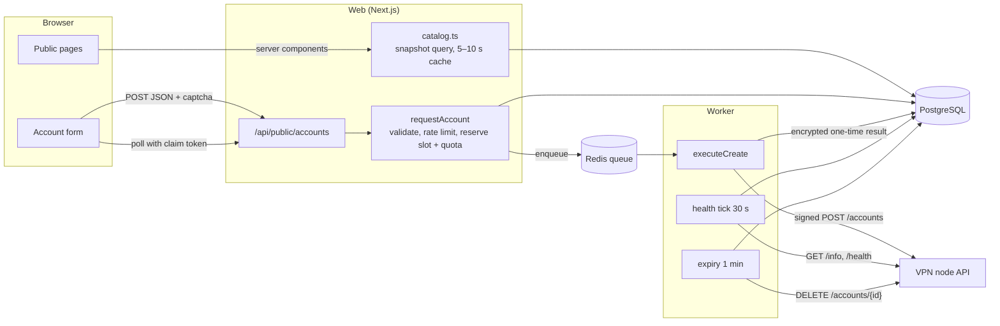

# 9. Public site, quotas, monitoring and avatars

The public website is where visitors pick a protocol, a country and a server and create a free account on it. It follows the same page flow as typical free SSH/VPN account sites (protocol → country → server → form → one-time result, plus a live server status page) with the site's own brand, wording and artwork. The brand name and texts come from **Admin → Site settings** (default "LitronSSH").

Code: pages in `src/app/(public)`, components in `src/components/public`, data in `src/server/public/catalog.ts`, JSON API in `src/app/api/public`, the data contract between them in `src/lib/public/types.ts`.

## Routes

| Path | Shows | Data |
| --- | --- | --- |
| `/` | Hero with live counters (servers online, countries, accounts today), one card per protocol (category, server count, country flags, availability), "how it works", sample DiceBear profiles, a live status strip, FAQ (reset times and validity filled in from the settings) | `listProtocolSummaries()`, `getSiteStats()`, `getStatusPage()` |
| `/<protocol>` | Countries for that protocol as tiles: flag, servers, availability, remaining slots, best ping; "What is …" and a connection guide (`src/lib/protocol-guides.ts`) | `getProtocolPage()` |
| `/<protocol>/<country>` | One card per server: host (if enabled), location, service ports, transports, validity, status and ping ("checked … ago"), "N slots left" with the reset countdown, **Create account** (disabled with the reason when unavailable), other protocols on the same server | `getCountryPage()` |
| `/<protocol>/<country>/<server>` | Account form (fields defined per protocol in Admin → Protocols) → progress → one-time result, in place. Side card: live status, ping, last check, slots and reset countdown, ports, validity options, the site's rules, other protocols, "Report a problem". When the server cannot take accounts, the form is replaced by the reason and other available servers in the same country | `getServerPage()` |
| `/server-status` | Every published server per protocol (offline ones included): status, ping, last check, remaining slots, Create / Full action; filters (protocol, country, availability, text); auto-refresh every 30 s (paused while the tab is hidden), "Refresh now"; `?protocol=<slug>` preselects a protocol | `getStatusPage()`, then `GET /api/public/status` |
| `/report` | "Report a problem" form; `?server=<id>&protocol=<slug>` preselects the server (linked from server pages) | `getStatusPage()` for the server list, `POST /api/public/reports` |
| `/my-accounts` | Accounts created **in this browser** (non-secret summaries from `localStorage`): avatar, protocol, server, username, live expiry countdown; accounts the server removed early show as **Removed**; remove with undo | Browser only (status from `POST /api/public/accounts/status`) |
| `/about`, `/contact`, `/privacy`, `/terms`, `/acceptable-use` | Static pages; contact options from the settings. The legal pages are template text marked **owner review required** (`src/app/(public)/_lib/legal.ts`) | Settings |
| `/sitemap.xml`, `/robots.txt` | Every published protocol, country and server page; `/admin` and `/api/` are disallowed | `listSitemapEntries()` |

Every page shares the same frame (`src/app/(public)/layout.tsx`): a top bar with the reset schedule, a live countdown and the admin's announcement; a sticky header with the Services menu, status link, My accounts and theme switch; a footer with contact, protocol links, legal links and (if enabled) account counters.

* URL segments: protocol slug (Admin → Protocols), country slug from the ISO code (`GB` → `united-kingdom`, `src/lib/slug.ts`), server slug (`de1`, see [Admin panel](03-admin-panel.md)).
* Unknown or malformed slugs return a real **404**: the `[protocol]`, `[country]` and `[server]` layouts validate the slug before anything streams. A protocol slug may not shadow a static route (`RESERVED_PROTOCOL_SLUGS` in `src/server/protocols/validation.ts`).
* Pages render per request (`await connection()`), so new servers and status changes appear without a deploy. A database outage still renders the frame: shared data degrades to empty states, and a protocol, country or server page shows a retry message instead of a false 404 (`src/app/(public)/_lib/data.ts`, `error.tsx`).

## Data flow

### Catalogue → pages

`src/server/public/catalog.ts` runs **one query** for every listed (server, protocol) pair and derives every page from that snapshot. A server is listed for a protocol when the protocol is enabled, the server/protocol row is enabled **and** detected, and the server is published (lifecycle `active` or `maintenance`, not deleted, compatibility not `unsupported`). Browse pages show servers whose status is online, full or maintenance; the status page also shows offline ones, and a server page stays reachable while its server is offline (it explains why). Results are cached per process (snapshot and status 5 s, pages 10 s).

The query never selects the server's IP address, management API port or credentials. The VPN hostname is included only when **Show server hostnames** is on (Admin → Site settings → Public display; default off, because the hostname is also the management API's address; users still receive it with their account).

**Availability** of a server for one protocol, in priority order: `maintenance` → `offline` (also an unsupported script) → `service_stopped` (the node reports the protocol's service as stopped) → `full` (server status full, or 0 slots left) → `available`.

**Latency** is the round-trip time of the last health check from the website to the server's management API (not from the visitor). It is shown green below 150 ms, amber below 400 ms, red otherwise.

### Public JSON API

| Endpoint | Purpose | Notes |
| --- | --- | --- |
| `GET /api/public/protocols` | Protocol summaries (`durationOptions`, `lockedDurations`, and `defaultDurationDays` = the default, or the shortest open duration when the default is locked) | cached 30 s |
| `GET /api/public/protocols/<slug>` | Form definition + countries | cached 30 s, 404 for unknown slugs |
| `GET /api/public/status` | `StatusPageData` for the status page | cached 5 s |
| `GET /api/public/servers` | Same data, for other consumers | cached 30 s |
| `POST /api/public/accounts` | Create an account → `202 {requestId, claimToken, state}` | same-origin JSON ≤ 16 KB, strict zod schema, captcha, rate limits; a locked duration → `422 VALIDATION_FAILED` with `fieldErrors.duration` naming the open ones |
| `GET /api/public/accounts/<requestId>` | Poll with header `x-claim-token` → `pending` / `failed` / `active` | `no-store`, 120 polls/min per IP; unknown ids and wrong tokens get the same 404 |
| `POST /api/public/accounts/status` | `{ids: [requestId…]}` (≤ 50, the ids My accounts keeps) → `{accounts: {<id>: {status: "active" \| "expired" \| "removed" \| "suspended", removedAt?, reason?, since?, until?}}}` (`suspended`: the server blocks it, `reason` `multi_login` \| `disabled` \| `expired`) | same-origin JSON ≤ 4 KB, `no-store`, 30/min per IP; database only (never asks a server), status only (no username, server or credentials); unknown ids are left out. `removed` = removed by the server (account check) or revoked by an administrator |
| `POST /api/public/reports` | Report a problem → `201 {id}` | same-origin JSON ≤ 8 KB, captcha, 3/hour and 10/day per IP |

Errors always have the shape `{"error": {"code", "message", "fieldErrors"?, "retryAfterSeconds"?, "resetsAt"?}}` (`PublicApiError`).

### Account creation → one-time result

1. The form (`create-account-panel.tsx`) checks the fields in the browser for instant feedback (`form-validation.ts`, mirroring the server rules) and sends `CreateAccountRequest` with a random idempotency key and, when enabled, the Turnstile token.
2. `POST /api/public/accounts` (`src/app/api/public/accounts/route.ts`): origin, content type and size check (`src/server/public/http.ts`), zod schema, captcha, then `requestAccount()`.
3. `requestAccount()` (`src/server/provisioning/service.ts`) validates the input against the protocol's form definition plus the adapter's hard guards, applies the per-IP rate limits, and in **one transaction with row locks** checks the server (not maintenance/offline), the protocol on that server (enabled, detected, service not stopped), reserves capacity and quota (below), creates the pending account and the provisioning request (input encrypted), then enqueues the job. A double click returns the same request.
4. The worker sends the predefined `POST /accounts` to the node with the request id as idempotency key (details: [Provisioning](05-provisioning.md)), parses the node's `config` with the protocol adapter and stores the presented account **encrypted** (AES-256-GCM, bound to the request id) with an expiry. Only non-secret metadata is kept on the account row.
5. The browser polls `GET /api/public/accounts/<requestId>` with the claim token (every 1–3 s, gives up after 2 minutes and offers "Check again"). The response adds the account's DiceBear avatar. The result view shows every field with copy buttons, QR codes (generated in the browser), file downloads, "Copy all" and a `.txt` export.

The result is available to whoever holds the claim token until `PROVISION_RESULT_TTL_SECONDS` (default 1 hour) passes; then the sweeper erases it and the page says it has expired. The claim token is derived from the idempotency key with `IP_HASH_SECRET`; only its SHA-256 is stored. In the browser the request id and claim token live in `sessionStorage` (this tab only, so a reload recovers the result), the result itself only in memory, and `/my-accounts` keeps non-secret summaries in `localStorage` (never passwords, UUIDs, keys, links or configs).

## Quota model

Three limits apply to every new account (`src/server/provisioning/capacity.ts`):

| Limit | Column | Counts | Freed when |
| --- | --- | --- | --- |
| Server cap | `servers.max_accounts` | live accounts (pending + active) | an account fails, is revoked or expires |
| Protocol cap (optional) | `server_protocols.max_accounts` | live accounts of that protocol | same |
| **Creation quota** (optional) | `server_protocols.quota_limit` | accounts **created** in the current reset window | only a definite provisioning failure gives the quota slot back |

* **Reset windows.** All quotas reset at the same local wall-clock times: Admin → Site settings → Quotas & resets, default `00:00` and `12:00` in the chosen IANA time zone (default `UTC`). A window runs from the latest reset to the next one; DST gaps and overlaps are handled (`src/server/provisioning/quota.ts`, tested across the Europe/Berlin DST switches).
* **Lazy reset.** Nothing runs at reset time. `server_protocols.quota_window_start` records the window `quota_used` belongs to; a row from an older window counts as 0 used. Reservation is one conditional `UPDATE` under row locks, so concurrent requests cannot exceed the quota. Usage is counted even without a limit, so a quota set mid-window is accurate.
* **Refunds.** Each account remembers the window it was counted in (`vpn_accounts.quota_window_start`). A definite failure gives the quota slot back if that window is still current; an uncertain outcome keeps both slots while it is being resolved, and for good (left for an admin to review) if it stays unknown. Revoked and expired accounts free their capacity slot but never the quota slot (the quota counts creations).
* **"N slots left"** = min(server cap left, protocol cap left, quota left) (`capacityOf()` in `catalog.ts`). The bar counts down from the quota when one is set, otherwise from the tighter cap. When a quota applies, the next reset time is shown as a countdown. The country tile sums the slots of its available servers.
* **Quota reached.** The API answers `409 QUOTA_REACHED` with `resetsAt` and a message naming the local reset time; caps answer `409 CAPACITY_REACHED`.
* **Defaults.** `quota.defaultLimit` (Admin → Site settings) is applied to server/protocol rows created by a later connect or sync; existing rows keep their own value. Per server, the quota is edited next to the caps in the setup wizard and on the server's Protocols page.

Separately from slots, each visitor (client IP hash) may send at most 5 account requests per minute and, per protocol, `max_accounts_per_ip_per_day` per day (default 3, Admin → Protocols). Both fail closed if Redis is down.

## Background jobs

The worker (`src/worker/index.ts`, `npm run worker`) runs two BullMQ queues so slow servers never block account creation:

| Job | Schedule | Code |
| --- | --- | --- |
| Account creation, reconciliation of uncertain outcomes | on demand | `provisioning/service.ts` |
| Sweeper: re-enqueue lost jobs, reconcile interrupted requests, erase expired one-time results, purge admin sessions | every minute | `sweep()` |
| Health monitor | tick every 30 s | `src/server/servers/health.ts` |
| Account expiry and node-side removal | every minute | `src/server/provisioning/expiry.ts` |
| Account check (accounts a server deleted itself) | every minute | `src/server/provisioning/account-check.ts` |
| Health history retention (7 days) | hourly | `purgeHealthHistory()` |

### Health monitor

Every published server (lifecycle `active`/`maintenance`, not deleted) is checked when its last check is older than **Settings → Health monitor → Check interval** (default 60 s, 30–3600 s). Due servers are claimed atomically, so overlapping ticks or several workers never check a server twice; up to 8 checks run in parallel. A check uses only the predefined `GET /info` and `GET /health` operations:

* success → the server is online (or degraded) immediately, the failure counter resets, and the latency, service states, versions and compatibility are stored;
* failure → `consecutive_failures + 1`; the server turns **offline** only after **Failures before offline** checks in a row (default 3), so one lost packet is not an outage. Offline clears the latency.

Each check adds a `server_health` row (kept 7 days; Admin → server detail shows a sparkline). Provisioning events are written only on transitions (online ↔ offline).

### Account expiry

Every minute, active accounts whose `expires_at` has passed become `expired` (batches of 100, `FOR UPDATE SKIP LOCKED`, safe with several workers) and release their capacity slot. When the server does not remove expired accounts itself (`capabilities.expiry_managed_by_node` is not true; the owner's nodes report `false`), a `revoke` request is recorded in the same transaction and the job sends the predefined `DELETE /accounts/<id>` with that request's id as idempotency key. A 404 counts as already removed; other failures retry with backoff (1, 2, 4 … 60 minutes, up to 12 attempts); a failure is logged in Admin → Logs.

### Account check

A server can delete an account on its own before it expires, for example when its multi-login limiter catches the account on too many devices. The website only learns about that by asking, so every minute the worker looks up active accounts with the predefined `GET /accounts/<id>`, each one once per **Settings → Health monitor → Account check** interval (default 5 minutes; 0 turns it off). New accounts are first looked up one interval after activation.

* **Blocked on the server:** when the account is found but the server reports `"status": "disabled"` (for example `"disabled_reason": "multi_login"`, banned by its multi-login limiter, optionally `"disabled_until"`) or `"status": "expired"` (expired there before the expiry date here), that is stored in `vpn_accounts.server_state*` and shown: Admin → Accounts badges it ("Banned: multi-login", "Blocked on server", "Expired on server") and has a **Blocked on server** filter, the details dialog says since and until when, Admin → Logs gets an `account.server_state` event when it starts and ends, and My accounts shows the card as **Banned** / **Blocked** / **Expired** with an explanation (the header and mobile menus no longer count it as active). Admins can also ask right away with **Check on server now** in the account's details; it shows the server's own words when they are not what the contract expects (e.g. `"status": "banned"` reads as active and is not shown as a ban). Display only: the account stays active, keeps its slot and expires as usual, and the mark clears as soon as the server reports the account active again (or no longer has it, or the check is turned off). A server's "expired" in the account's last 10 minutes here is taken as clock skew, not an early expiry.
* **Missing** means the server answered `404` with the contract error code `ACCOUNT_NOT_FOUND`, or returned the account with `"status": "revoked"`; **found** means it returned the account. Only these answers count (`vpn_accounts.answered_at`). A bare 404 (wrong base path, a proxy page, an agent without that route), a timeout or any other error is no answer and changes nothing.
* The first miss only records `vpn_accounts.missing_since`. If the account's next regular lookup, one interval later, misses again and every safety check below passes, it becomes **`removed`** (`revoked_at` = when), its slot is released, and Admin → Logs gets an `account.removed` event. Found again → the miss is forgotten. An account the server deleted therefore shows as removed within about two intervals (10 minutes by default).
* **Safety checks**, per server and protocol (a lookup can break for one protocol only, e.g. Xray but not SSH). They look at the protocol's accounts on that server that existed before the misses started and were answered since:
  * *Known good:* at least one of them must have been found in a later check than the misses (a "found" from the same check may predate the breakage). Otherwise a broken lookup cannot be ruled out and nothing is removed. Accounts created after the misses started do not count. (So a protocol with a single account on a server, or one whose accounts all disappear at once, is never cleaned up automatically: revoke those by hand.)
  * *Share:* when at least 3 and at least half of them are missing, nothing is removed, and that verdict sticks (`server_protocols.account_lookup_suspect_at`): accounts that went missing before it are never removed automatically, whatever happens later; only finding them again or revoking them clears them.
  * *Unreliable:* when an account reported missing is found again, removals of that protocol on that server wait 2 hours (`account_lookup_false_miss_at`).
  * *Rate:* at most max(10, 20 % of its active accounts) removals per server per hour; the rest wait for a later check.
  Held accounts stay active with **Missing on server** in Admin → Accounts (and in their details), and Admin → Logs gets a warning naming them, at most once an hour per server and reason. Accounts the server really deleted can be revoked there (a 404 on revoke counts as success). Changing a server's connection settings, credentials, address or driver clears its verdicts. Turning the check off clears every Missing and Blocked mark.
* **Load:** one short request per account per interval (an account counts as due 15 seconds early, since runs are a minute apart give or take; without that, one checked by a slightly late run waited a whole extra minute), runs never overlap (a Redis lock: a run that starts while the previous one is still going leaves its accounts to the next), at most one request in flight per server, at most 40 lookups per server and 200 in total per run (the per-server cap is applied in the query, so a big server never crowds out the others; a big server just takes longer to go round), servers marked offline are skipped, the first connection failure stops that server's lookups for the run, accounts a run did not get to (time budget, connection failure) go back to the front of the line, and an account whose lookup failed or timed out waits for the next interval. A server that cannot answer the lookup at all (no such route, answers outside the contract, refused credentials) in two checks in a row is skipped for an hour with a warning in Admin → Logs; a passing server error (5xx) does not pause it. A protocol whose lookups only fail for three checks in a row while the server answers the others gets a warning too. Nothing secret is sent or logged.
* When a removed account reaches its expiry date, the expiry job still sends the usual `DELETE` (a 404 counts as done), so even a wrong removal never outlives the expiry on the server. It is skipped on servers that expire accounts themselves, and while a live account on that server uses the same node account id or username (checked again right before the `DELETE` is sent).
* Every public page asks about the saved accounts that are still running (when it opens, when the tab comes back into view and every minute while it stays in view, at most once a minute per tab, `POST /api/public/accounts/status`; a database read, never a request to the server) and keeps the answer in the browser, so My accounts, the header menu and the mobile menu all show them as **Removed** or **Banned** / **Blocked** / **Expired on server**. A ban whose end time has passed is no longer shown as current.

## DiceBear avatars

Every VPN account and every administrator gets an avatar automatically. Avatars are generated **on the website server** with `@dicebear/core` and `@dicebear/collection` 9.4.3 (MIT) as SVG data URIs (`src/server/avatar.ts`): no request to DiceBear or any other third party, nothing about the user leaves the server, and the CSP stays `img-src 'self' data: blob:`.

| Seed | Used for |
| --- | --- |
| `account:<account id>` | The account's avatar: one-time result, My accounts, Admin → Accounts |
| `admin:<admin id>` | Admin header menu, Administrators page, My account |
| `sample:<name>`, `about:<name>`, `vaultline-hero-traveller` | Decorative profiles on the home and About pages |

The same seed always gives the same picture. Avatars are derived, not stored, so changing the style (Admin → Site settings → Avatars) changes them everywhere at once, except the summaries already saved in a visitor's My accounts list, which keep the picture they were saved with. Admin → Accounts loads them from `/admin/accounts/avatar/<id>` (SVG with its own locked-down CSP, `accounts:view` required) instead of inlining every data URI into the page.

Offered styles (`src/lib/avatar-styles.ts`) are limited to artwork that allows commercial use without attribution, so the site needs no credit line:

| Licence | Styles |
| --- | --- |
| CC0 1.0 | Thumbs (default), Notionists, Notionists neutral, Lorelei, Open Peeps, Pixel art, Identicon, Shapes, Rings, Glass, Initials |
| Free for personal and commercial use | Bottts, Bottts neutral, Avataaars |

## Captcha

Both public POST endpoints (accounts, reports) call `verifyCaptcha()` (`src/server/captcha.ts`).

| Variable | Value |
| --- | --- |
| `CAPTCHA_PROVIDER` | `none` (default) or `turnstile` |
| `TURNSTILE_SITE_KEY` | Public site key; required when the provider is `turnstile` |
| `TURNSTILE_SECRET_KEY` | Secret key, server only, never logged; required when the provider is `turnstile` (the environment check rejects the configuration without both keys) |

With `turnstile`, the form renders the Cloudflare Turnstile widget and the server verifies each token with Cloudflare's `siteverify` endpoint (5 s timeout, sends the client IP as `remoteip`). It **fails closed**: a missing or oversized token, a missing secret, a timeout, a network error or any answer other than `success: true` refuses the request with `403 CAPTCHA_FAILED`. A rejected secret is logged as an operator error. Only then does the CSP allow `https://challenges.cloudflare.com` (`script-src`, `connect-src`, `frame-src`); apart from Google's ad script when AdSense is enabled (see [Advertising](#advertising-google-adsense)), it is the only third party the site loads. With `none`, the forms rely on the rate limits alone and production logs a warning once.

## Guides

`/guides` and `/guides/<slug>` are original help articles (setting up the apps, what each protocol does, troubleshooting, privacy and fair use), linked from the header's Support menu, the footer, the mobile menu, the sitemap and each protocol page ("More help with …"). Each article is a typed data file in `src/lib/guides/articles/` (format: `src/lib/guides/types.ts`; text supports only `**bold**` and `[label](/internal/path)`), listed in `src/lib/guides/index.ts` and rendered by one component (`src/app/(public)/guides/`), with Article and FAQ structured data. Articles never link a protocol page in their text, because those pages only exist while the protocol is listed: their `protocols` field drives "Create account" buttons for the protocols listed right now. `tests/unit/guides.test.ts` checks every article: length, links, related guides and wording that an AdSense review could read as helping people get service they have not paid for.

## Advertising (Google AdSense)

Off by default. With `ADSENSE_CLIENT_ID=ca-pub-…` (or `pub-…`) in `.env` (`src/lib/adsense.ts`):

* each content page loads Google's Auto ads script (`<AdsenseScript />` from `src/components/public/adsense-script.tsx`: `adsbygoogle.js?client=…`, with the CSP nonce). It is not in the public layout, so the 404 and error screens, My accounts and the admin panel do not load it when opened directly, which is how Google's crawler and reviewers see them (Google allows no ads on screens without publisher content). After a client-side navigation from a content page the already loaded script stays in the document, with any anchor or side-rail ad it placed, as on any single-page site; do not hide or remove Google's ad elements, which is itself against the AdSense policies. Add it to any new content page;
* `/ads.txt` answers Google's line (`google.com, pub-…, DIRECT, f08c47fec0942fa0`); without the variable it is a 404;
* the CSP of public pages follows Google's strict-CSP guidance (scripts still need the nonce or a nonced loader; `'unsafe-eval'`; `https:` for frames, images and requests, because Google's ad hosts change); admin pages keep the strict policy;
* the privacy page gains an Advertising section (Google's cookies, opt-out links, consent in the EEA, UK and Switzerland) and its summary no longer says "no advertising".

Ad placement and the consent message for the EEA, UK and Switzerland are set up in the AdSense dashboard (Auto ads, Privacy & messaging). A malformed value stops the server at start-up with a clear error, like the captcha keys.

## Admin settings and reports

**Admin → Site settings** (`/admin/settings`, permission `settings:manage`: Super Admin and Administrator) edits one JSON document in `site_settings`, validated by `src/lib/site-settings.ts` on every read and write. Changes reach every process within a few seconds (5 s settings cache, plus the catalogue's short cache) and are audited with the names of the changed sections.

| Section | Settings |
| --- | --- |
| General | Site name, tagline, search description |
| Announcement bar | On/off, text, tone (info/success/warning), optional link (site path or `https://` URL only) |
| Public display | Show server hostnames; show account statistics in the footer |
| Quotas & resets | Reset times (`HH:MM`, up to 24), time zone, default quota for new protocol rows (preview of the next reset) |
| Account durations | Lock or unlock each duration the enabled protocols offer (one tile per duration). Locked ones stay on the create form with a padlock but cannot be chosen, the API refuses them, and "valid for" texts list only open ones. Saving is refused when an enabled protocol would have no open duration left. Migration `0005` locks 7, 14 and 30 days on an existing site |
| Health monitor | Check interval, failures before offline, **account check** interval (minutes, default 5, 0 = off; see [Account check](#account-check)) |
| Avatars | DiceBear style with previews and licence |
| Contact | Support email, Telegram `https://t.me/…` link |
| Account rules | Up to 10 short rules shown next to every account form |

**Reports.** Visitors report a problem with a category (can't connect, slow or unstable, account not working, something else), a 10–2000 character message, an optional server and protocol and an optional reply email. The client IP is stored only as a keyed hash. **Admin → Reports** (`reports:view`; all four roles) lists them in Open / Resolved / All tabs; `reports:manage` resolves a report with an optional note (up to 500 characters) or reopens it, both audited. The open count appears as a badge in the admin navigation and as a dashboard tile.

The other admin additions (server URL names, per-protocol quotas, account avatars and revoke) are described in [Admin panel](03-admin-panel.md).

## Security notes

* **The browser never talks to a VPN server.** Listings, the status page and the public API carry no IP address, management API port or credential (`catalog.ts` does not select them); the hostname only when the admin enables it. The user's own one-time result contains what their app needs to connect (host and, for the SSH family, the server IP), never the management API port.
* **Predefined operations only.** The public API can only request an account on a published server; the worker turns that into the fixed `POST /accounts`; health checks use `GET /info` and `GET /health`; expiry uses `DELETE /accounts/<id>`. There is no endpoint that takes a command.
* **Public POST endpoints:** same-origin check (`Origin` must be the site), `application/json` only, body size limits enforced while streaming, strict zod schemas (unknown keys rejected), adapter guards on usernames and passwords (safe character sets, reserved names), rate limits keyed by `hashClientIp()` (HMAC with `IP_HASH_SECRET`, raw IPs are never stored), captcha failing closed.
* **No secrets at rest or in logs.** Form input and results are encrypted and erased (input when the request finishes, the result after its TTL); `vpn_accounts.metadata` holds only non-sensitive values; logs and event details pass through `redact()`. Public responses that may carry secrets are `no-store`.
* **Text stays text.** Admin-entered and node-provided text is rendered by React (escaped). The only raw HTML is the structured-data `<script>` in `json-ld.tsx`, whose JSON escapes `<`, `>` and `&`. Links from settings are validated on save and again when rendered (`safeHref()` in `src/lib/seo.ts`: a site path or an `https://` URL, never `javascript:`).
* **Self-hosted assets.** Fonts (`@fontsource-variable/inter`, `jetbrains-mono`), flags (`flag-icons`), QR codes (`qrcode`, in the browser) and avatars are all served from the site; CSP `font-src 'self' data:`, `img-src 'self' data: blob:`, nonce-based `script-src`. The only third-party scripts are the captcha and, when enabled, Google AdSense, which widens the public pages' CSP (see [Advertising](#advertising-google-adsense)).
* **Client IP.** Taken from `X-Forwarded-For` counting `TRUSTED_PROXY_HOPS` from the right; keep the app behind the reverse proxy so the header cannot be forged.

Tests: `tests/integration/{catalog,public-api,quota,monitoring,reports}.test.ts`, `tests/unit/{quota,reset-schedule,public-cache,public-browse,public-create,slug-avatar,captcha,proxy-csp,owner-adapters}.test.ts`.
